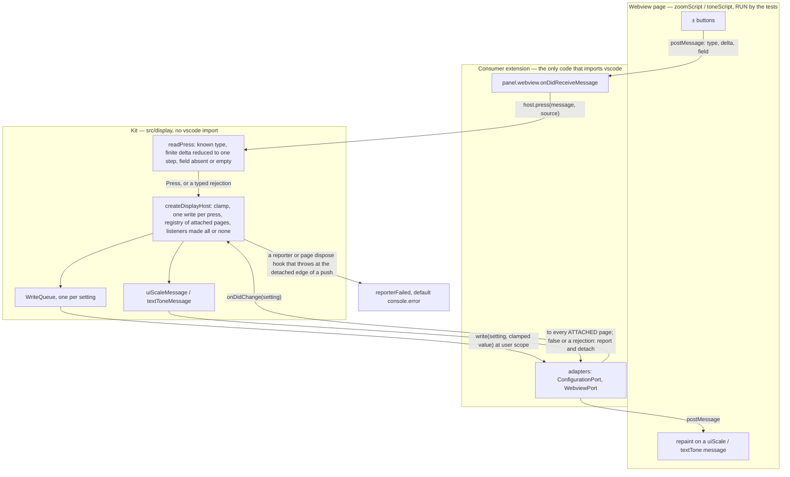
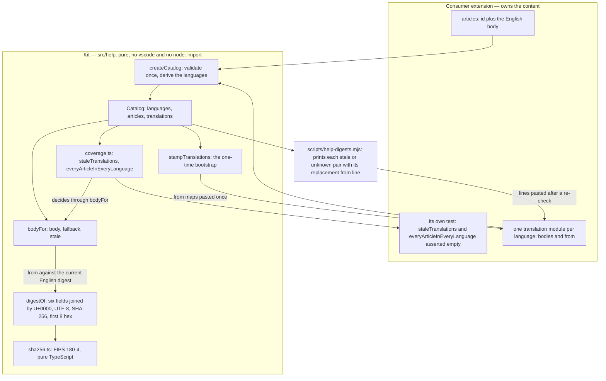
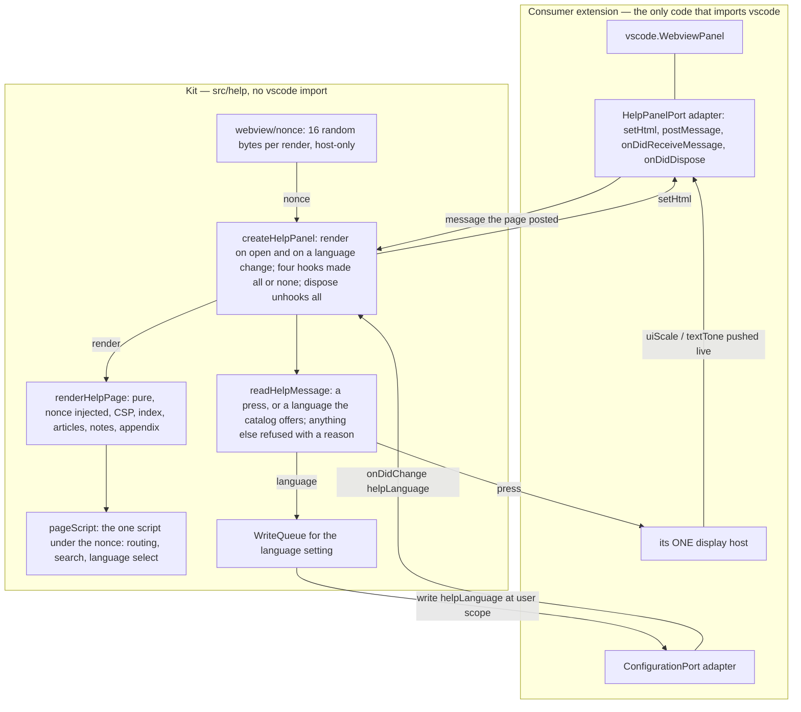
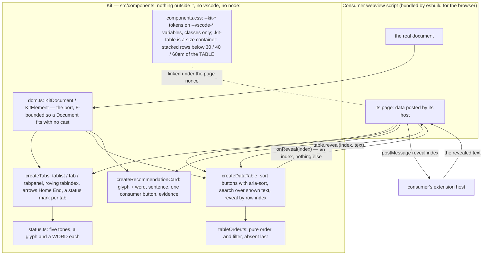
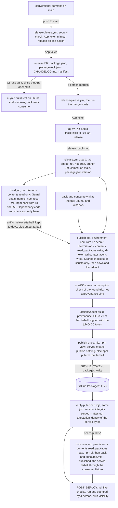

# Architecture — dew_flow_vscode_kit

> Being built along [../todo/PLAN_extract_the_kit.md](../todo/PLAN_extract_the_kit.md): epic 1 (the
> machinery and the pure modules) and epic 2 (the display host, the help catalog, and the help page and
> panel) have landed; of the release pipeline (epic 3), the pre-publish check that packs, installs, bundles
> and runs the tarball (E3.S1) and the publishing half — release-please and `release.yml` (E3.S2) — are in
> the repository, but **nothing is published yet** (0.1.0 never reached a registry; 0.1.1 will be the first publish, to GitHub Packages): the first release waits for the owner's one-time
> setup (README "Release and rollback"). This file describes what exists and is rewritten as each module
> lands. Since K1 ([../todo/PLAN_kit_components_storybook.md](../todo/PLAN_kit_components_storybook.md), wsl_care's
> E18.K1) the package also has the webview components behind a second entry, `./components`, their stylesheet, and
> a Storybook.

## What this package is

`@oleksandrdubyna88/vscode-webview-kit`: the webview building blocks two VS Code extensions share instead
of copying. Pure modules render strings from values and are tested as functions; page scripts are
strings a webview runs and are tested by RUNNING them; the few host modules take a narrow port instead
of the `vscode` namespace and are tested with a fake stricter than the real API. Nothing in `src/`
imports `vscode` — `src/test/architecture.test.ts` fails the build if a pure module does, and the only
`node:` import outside the tests is `src/webview/nonce.ts` (`node:crypto`). Since E2.S3 the same test also
walks run-time import CLOSURES: no module a page is rendered by may reach `nonce.ts` even one hop away,
while the help panel — the host half that mints a nonce per render — must.

## Module map

| Module | Files | Status |
|---|---|---|
| `text` | `asText.ts` | landed (E1.S2) |
| `webview` | `escape.ts` (`escapeHtml`, `escapeHtmlForHighlighting`, `jsonForScript`), `nonce.ts`, `writeQueue.ts`; `posted.ts` — a posted message read as own members only, shared by both message readers; `hooks.ts` (`hookAll`, internal) — a constructor's hooks made all or none | landed (E1.S2; `posted.ts` E2.S3; `hooks.ts` epic 2 code round) |
| `settings` | `settingWritten.ts` — the "a view setting could not be saved" reporter, consumer funnel injected | landed (E1.S2) |
| `display` — pure halves | `config.ts` (`createDisplayConfig`, prefix validation), `zoom.ts`, `tone.ts`, `messages.ts` | landed (E1.S3; `messages.ts` E2.S1) |
| `display` — host | `port.ts` (`ConfigurationPort`, `WebviewPort`), `press.ts` (`readPress`), `host.ts` (`createDisplayHost`) | landed (E2.S1) |
| `help` — catalog | `types.ts`, `sha256.ts`, `digest.ts` (`digestOf`), `catalog.ts` (`createCatalog`, `bodyFor`), `bootstrap.ts` (`stampTranslations`), `coverage.ts` (`staleTranslations`, `everyArticleInEveryLanguage`) | landed (E2.S2) |
| `help` — page, panel | `page.ts` (`renderHelpPage`, `searchIndex`, `articleHtml`, `helpCsp`), `pageText.ts` (chrome, section labels, `bodyHtml`, the notes), `pageScript.ts` (the one `<script>`), `messages.ts` (`readHelpMessage`), `panel.ts` (`createHelpPanel`, `HelpPanelPort`) | landed (E2.S3) |
| package entry | `src/index.ts` — the whole 0.1.0 API: `display`, `settings`, `text`, `webview`, the help catalog, page, message reader and panel; pinned name by name by `src/test/exports.test.ts` | landed (E2.S3) |
| bin | `scripts/help-digests.mjs`, shipped as `vscode-webview-kit-help-digests` (`package.json` `bin` and `files`) | landed (E2.S2; shipped E2.S3) |
| `components` (entry `./components`) | `dom.ts` (the DOM port: `KitDocument`, `KitElement`, the tag / attribute / event surface), `checks.ts` (the door's refusals), `status.ts` (`STATUS_TONES`, a mark = glyph + word), `tabs.ts` (`createTabs`), `tableOrder.ts` (sort and filter, pure), `dataTable.ts` (`createDataTable`), `recommendationCard.ts` (`createRecommendationCard`), `index.ts` (the entry), `components.css` (theme tokens and rules, shipped as `./components.css`) | landed (K1) |
| Storybook | `.storybook/` (`main.ts`, `preview.ts` with the theme and size toolbars, `vscode-themes.css` — VS Code's resolved reference-theme values, `gallery.css`), `stories/*.stories.ts` over `src/test/gallery/` | landed (K1); a devDependency, never shipped |
| layout check | `scripts/layout-check.mjs` (headless Chrome over the DevTools protocol), `.storybook/layout-page.ts` (the page it loads: the gallery's DOM cases twice, plus the overflow probe) | landed (K1, 4.6a); a development check, never shipped |

## The display module

Two controls every page carries — ± text size (`uiScale`) and ± text tone (`textTone`) — each a GLOBAL
setting so a vision preference follows the person to their next machine. The page reports which way a
button was pressed and never the result; the host clamps, writes once, and the setting's change event
repaints every open page from the one stored value. Two open pages never show two sizes, because there is
no per-page state to disagree.

**The trust boundary** is `press.ts`. A message is read as own properties only; it must carry `type`
`zoom` or `tone`, a `delta` that is a finite number (truncated, then one step in its direction — below a
whole step is no press and no write), and a `field` that is absent or `''`. Everything else comes back as
`{ accepted: false, reason }` — `not-an-object`, `unknown-type`, `delta-not-a-number`, `no-step`, `field`
— and `readPress` never throws. ConnectOtherAIs at `1056aed9` had this rule in three parsers that
disagreed on a sub-step delta; the kit keeps the unified one (`textControlFrom`).

**The ports** (`port.ts`) are the subset of `vscode` the two coai host modules used, shaped so a consumer's
adapter is a few lines: `ConfigurationPort` reads a setting raw, writes it to the user scope (a
`PromiseLike`, so `WorkspaceConfiguration.update`'s thenable passes straight through) and watches it;
`WebviewPort` posts a `DisplayMessage` and exposes the PANEL's dispose event, which a `vscode.Webview`
itself does not carry.

**The host** (`host.ts`, finding 1 of the epic 2 plan round) keeps a registry: `attach(webview)` pushes both
current values at once, returns a disposable, and is also undone by the page's dispose event; a change
pushes only the changed setting's message, to attached pages only; a `postMessage` that resolves `false`
or rejects is caught, reported through `DisplayReporter.pushNotDelivered`, and detaches that page; a push
never runs inside the write queue, so a page that never answers cannot block a write. A failed write is
reported once through `settingWritten` with the consumer's `settingNotSaved` funnel. `dispose()` unhooks
both setting listeners and every page; `attach`, `press` and `apply` after it throw synchronously, and a
press still queued behind a write in flight is dropped when the queue reaches it — the in-flight write
lands, nothing after it does (gate, epic 2 code round, finding 0).

**Lifetime edges** (same round, findings 2 and 4). The two setting listeners are made all or none through
`webview/hooks.ts`'s `hookAll`: a registration that throws undoes the ones before it, newest first, before
its error is rethrown — the help panel's four hooks are made the same way. A push is a detached execution
whose outermost frame catches everything: a `pushNotDelivered` that throws (the page is already detached)
or a page dispose hook that throws goes to the optional `DisplayHostOptions.reporterFailed`, which
defaults to `console.error` — a global, so no `node:` import — and one that throws itself is logged to
`console.error` with both errors. The promise a push leaves behind never rejects.

**Byte-compatibility.** For coai's configuration (`ConnectOtherAIs`, prefix `coai`, section `coai`) the
markup, scripts, CSS, pushed messages and written values equal what coai's own modules produced at
`1056aed9`. The expected values are RECORDED from those modules by `scripts/record-coai-display.mjs` —
the host halves through a typed `vscode` stub — into `src/test/fixtures/coai-display-1056aed9.json`,
never retyped.

**Growth** (plan §5): one write queue per setting, as long as the presses not yet written; one attachment
per open page, each leaving on dispose, detach or a failed push. No files, no caches.

## The help module — the catalog half (E2.S2)

The help page reads one catalog: the consumer's articles (English, in index order) and one translation
module per language. `createCatalog` checks that input once; `bodyFor(catalog, article, language)` answers
`{ body, fallback, stale }`. The page and the panel that render it are E2.S3.

**`body` and `fallback` are coai's.** For an article in English, the English body; in another language,
that module's own body, or English with `fallback: true` when it has none. The answers are held against
ConnectOtherAIs' own `bodyFor`, RECORDED by `scripts/record-coai-help.mjs` from coai's `helpContent.ts` at
`1056aed9` — over small partial translation modules written by the recorder, and over coai's real id
coverage (33 articles, four modules) — into `src/test/fixtures/coai-help-1056aed9.json`. One deviation, with
the evidence in the recording: coai looked a body up through the prototype, so an article whose id is a
key of `Object.prototype` (`constructor`) got the Object function back as its "translation"; the kit reads
own properties only and answers the English fallback.

**`stale` is the kit's.** Each translation module is `{ bodies, from }`: `from` maps an article id to the
digest of the English body it was translated from. `fresh` when that equals the current English digest
(and always for English itself and for a fallback, which ARE the current English), `stale` when it
differs, `unknown` when the module records no `from` for a body it has — never assumed fresh.

**The digest** (`digest.ts`, plan §2): the six fields in the fixed order `title`, `whatItIs`, `why`,
`setup`, `usage`, `whatCanGoWrong`, joined with U+0000, UTF-8, no other normalisation — a CR, a trailing
space, a decomposed accent are each an edit of the English — then the first 8 hex characters of SHA-256.
32 bits is a change detector, never an integrity check.

**Why SHA-256 is pure TypeScript here and not `node:crypto`.** `bodyFor` is on the path of the PURE page
module (E2.S3 renders the stale note from it), and `architecture.test.ts` scans each file for `vscode` /
`node:` imports — a host-only `digest.ts` would have made `catalog.ts`, and through it the page, host-bound
by import while every per-file scan stayed green. Web Crypto's `subtle.digest` is asynchronous and would
make `bodyFor` a promise. So `sha256.ts` is a plain FIPS 180-4 implementation (~100 lines), used for change
detection only, pinned by the standard's five vectors and a differential run against `node:crypto` over
every length 0–200 and 300 seeded random strings (lone surrogates included). The host allowlist did not
grow: the only `node:` import outside the tests is still `src/webview/nonce.ts`.

**The boundary.** `createCatalog` refuses, with a `TypeError` naming what, where and what would be
accepted: no articles; an empty or repeated id; a body missing any of the six fields (English or
translated); a module for a language the help does not have (or for `en`); a translated body for an article
the catalog does not have; a `from` entry with no body beside it; a `from` that is not 8 lowercase hex. The
languages are derived — English, then each language with a module, in `HELP_LANGUAGES` order. Input is
never written, and never held (gate, epic 2 code round, finding 5): every article, body, translation and
`from` map is COPIED first — a body as its six fields, each read once — and the copy is what is checked,
frozen all the way down and kept, so an edit to the input after `createCatalog` changes nothing `bodyFor`
or the page shows. The translated-body check looks ids up in a `Set` made once per catalog, and a page
render walks `catalog.articles` once rather than finding each article by id (findings 6 and 7).

**What a consumer's CI asserts** (epic 2 plan round, finding 0). `staleTranslations(catalog)` lists every
translated body that is `stale` or `unknown` as `{ article, language, stale, from, current }` (`from` is
`null` when unknown), in article then language order; a consumer asserts it empty, so an English edit
committed without its translations fails that consumer's build rather than reaching a reader.
`everyArticleInEveryLanguage(catalog)` is coai's "every article exists in every language" check, as
`{ complete, missing }`. Both decide through `bodyFor`, so neither can disagree with what a reader sees.

**The bootstrap and the script.** `stampTranslations(catalog)` returns new modules with every body's `from`
stamped to today's English digest — run ONCE at a consumer's switch, on the stated assumption that its
shipped translations match today's English, and the result pasted into its modules; run on every build it
would switch stale detection off. After a deliberate re-translation, `scripts/help-digests.mjs <compiled
catalog module> [--export name] [--kit entry]` re-makes the catalog with the kit's own `createCatalog`,
prints exactly `staleTranslations`' pairs grouped by language with the replacement `from` line for each,
and exits 1 (0 when nothing is stale, 2 on a usage, load or validation error). Since E2.S3 it ships:
`package.json` lists it in `files` and as the bin `vscode-webview-kit-help-digests`, and its default
`--kit` is the package's own `dist/index.js` resolved from the script's location (`import.meta.url`),
never from the cwd — so the installed bin uses the kit it was installed with.

**Growth:** none. The catalog is made once from the consumer's constants; nothing is cached or kept.

## The help module — the page and the panel (E2.S3)

The page is PURE: `renderHelpPage({ catalog, language, display, nonce, uiScale?, textTone?, appendix? })`
returns the whole HTML document as a string, and every input is handed in — the nonce included, which the
host mints per render. The panel is the HOST half, behind a fourth port, `HelpPanelPort`: the consumer
creates the `WebviewPanel` (that needs `vscode.window`) and adapts it in four lines.

**Byte-compatibility.** For coai's configuration (`ConnectOtherAIs`, prefix `coai`), the same nonce and the
same appendix, `renderHelpPage` returns the bytes coai's `renderHelpHtml` returned at `1056aed9` — for every
language, at the theme's own size and tone and at two off-centre pairs — and `searchIndex`, `articleHtml`
and `bodyHtml` equal coai's for every recorded input. The pages are RECORDED from coai's real `helpPage.ts`
by `scripts/record-coai-help-page.mjs` into `src/test/fixtures/coai-help-page-1056aed9.json`: coai's engine,
escapers and display controls compiled as they are, its `HELP_ARTICLES` export reassigned to small
synthetic articles (recorded as input), its four translation modules and `helpPrompts.ts` replaced by small
files, and the nonce read back from each page it rendered. coai's appendix — the private `promptsHtml()` it
put inside the `prompts-in-full` article — is recovered from coai's own output as the difference between that
article and a twin with the same body under another id, and the recorder refuses unless both renders
reassemble from it. A consumer's appendix is its own escaped markup, inserted as is.

**The CSP and what is checked at the door.** The policy is coai's, byte for byte:
`default-src 'none'; style-src 'unsafe-inline'; script-src 'nonce-…';`. `default-src 'none'` means no image,
font, frame, connection or form reaches anywhere; scripts run only under the per-render nonce, and the page
has exactly one script and no inline handler. `style-src 'unsafe-inline'` is kept because the page's own
`<style>` carries only the kit's constants and two clamped numbers — never a consumer's or a reader's text —
and dropping it would break byte-compatibility for no gain. Two inputs reach an attribute unescaped and are
therefore checked: the nonce must be at least 22 base64 characters (128 bits, the CSP specification's
floor; what `nonce()` mints passes), and the language must be one of `catalog.languages`. Article text is
escaped before any markup of ours is added; data reaches the script only through `jsonForScript`, which
`src/test/scriptInterpolation.test.ts` enforces by scanning every shipped source for an interpolated
`JSON.stringify`.

**What the kit adds to coai's page.** The language switch lists `catalog.languages` — English and the
languages with a module (all five for coai) — instead of all five unconditionally. A translation `bodyFor`
answers as `stale` or `unknown` carries a note where the fallback note goes, in the help's language
(`
`, so the stylesheet is unchanged); a fresh catalog renders no note at all, which
is what keeps coai's bootstrapped catalog byte-identical. A fallback is never stale: it IS the current
English.

**The trust boundary, help side** (`messages.ts`). `readHelpMessage(message, catalog.languages)` reads own
members only (`webview/posted.ts`, shared with `display/press.ts` so the rule lives once), hands `zoom` /
`tone` to `readPress` unchanged, and accepts `language` only as a string the catalog offers with a `field`
absent or empty. Everything else comes back as `{ accepted: false, reason }` — `not-an-object`,
`unknown-type`, `language-not-offered`, `field`, or a press reason — and the reader never throws. coai checked
the language against all five and ignored other types silently; the kit narrows the first and names the second.

**The panel** (`panel.ts`). `createHelpPanel` renders first, then makes four hooks: the display attachment
(the consumer's display host pushes size and tone to this page like any other), the language setting's
change listener (re-render), the port's message listener, and the port's dispose event — all or none
through `hookAll`, so a later registration that throws detaches the display attachment and releases the
earlier listeners before its error is rethrown (gate, epic 2 code round, finding 3). A press goes to
`display.apply`, which writes once and pushes the new value live — a size change never re-renders, so the
reader keeps their place; a language goes through the panel's own `WriteQueue` and `settingWritten` with the
consumer's `settingNotSaved` funnel, naming `help`. The stored language reads as English when it is junk or
a language the catalog has no module for. `dispose()` — or the panel closing — unhooks all four and leaves
the consumer's display host alone; `render` and `handle` throw afterwards, and a language write already in flight still lands while a choice still queued behind it is dropped — the display host's rule.

**Growth** (plan §5): one panel holds four hooks and one write queue as long as the language writes not yet
done; a closed panel holds nothing.

## The components module — Tabs, DataTable, RecommendationCard (K1)

The first part of the kit that runs INSIDE a webview as code rather than as a page script string: the consumer
bundles `./components` for the browser into its own webview script, and each component builds DOM there from the
data its page was posted. They exist for wsl_care's full view (its E18.W1), whose page CSP is nonce-only for scripts
AND styles and whose page harness refuses `innerHTML`, `style` and anything it does not model — so a component
creates elements, writes text with `textContent`, sets attributes from a closed list, and paints with classes alone.

**The port** (`dom.ts`). A component takes its document as an argument: `KitDocument<E>` with `createElement` over a
closed tag list, and `KitElement<E>` with `className`, `textContent`, `hidden`, `setAttribute`, `appendChild`,
`addEventListener` (`click`, `keydown`, `input`) and `focus`. `E` is the element type itself, so the real `document`
satisfies the port and the components hand back the page's own `HTMLElement` — measured before the plan and held by
the consumer fixture's webview entry, which is type-checked against the installed `.d.ts` with the DOM library. The
kit itself still compiles without the DOM library (`tsconfig.json`), so no component can reach a browser global by
accident. `KIT_TAGS`, `KIT_ATTRIBUTES` and `KIT_EVENTS` are the surface as data — what a consumer's strict harness has
to model, and what the kit's own strict fake enforces.

**Every word and number is the consumer's.** Labels, units, number formats, sentences, the reveal's text: a column's
`value` sorts and its `format` shows; absence (`null`, or `NaN`) shows as `—` and sorts last both ways
(`common.coding-style`). The kit's own English is three defaults a consumer can replace: `Showing 3 of 10 rows.`,
`No rows match.`, `Show`, and `Evidence`.

**The reveal** tells the consumer a row's index in the rows it gave — after a sort or a search, still that index — and
nothing else; the hidden text enters the DOM only through `reveal(index, text)`, into that row's cell alone and only for a row a person
asked about in the current rows (otherwise it answers `false` and changes nothing), and `setRows` drops every revealed text and every
pending request. **Tabs** select on a person's click or key (arrows wrap; Home, End), tell
`onSelect` only then, and take a status mark (a tone AND its word) live through `setStatus`. **The card** places ONE
button the consumer built — anything but a `BUTTON` is refused — and wires nothing on it.

**Fit, never scroll** (K1 4.6a, the owner's rule of 2026-10-15). A table is never a scroll container and never wider
than its box. `.kit-table` is a CSS size container (`container: kit-table / inline-size`), so every width rule reads the
TABLE's own width, not the window's: a table in a narrow card adapts at 1920 px too. Columns shrink and wrap — a header
breaks only between words (`overflow-wrap: break-word`), a cell anywhere as a last resort (`anywhere`), an end-aligned
cell stays on one line only above 30em. The `stack` option (`'narrow' | 'medium' | 'wide' | 'never'`, default
`'medium'`, an unknown value refused naming the four) puts `kit-table--stack-<value>` on the `table` element — on the
table and not on the root, because a container query styles the container's descendants only. Below 30 / 40 / 60em
each row becomes "label: value" lines: every body cell carries `data-kit-label` (its column's header; the reveal
cell its header; the empty-result row none) and the stylesheet draws it with `td[data-kit-label]::before`; the header
row becomes a wrapped row of the sortable headers' buttons after a CSS-drawn `Sort by`, so click / Enter / Space still
sort; a header with no sort button is hidden there. `stack: 'never'` has no block: a table at every width. Hiding
columns is deliberately not offered — it would hide data the consumer chose to show.

`scripts/layout-check.mjs` proves it where it can be proved, in a browser: it bundles `.storybook/layout-page.ts` (esbuild,
already a devDependency) for the browser, writes one static page with `components.css`, the theme fixture and the
gallery frame CSS into a git-ignored `testsToDelete-layout-check/`, drives headless Chrome with Node's own `WebSocket`
(`Emulation.setDeviceMetricsOverride` sets the viewport; `--window-size` cannot go under ~500 px), and at 300 / 1280 /
1920 px × four themes × three sizes asks the page's probe about every DOM case rendered in the page and in an 18em box.
The matrix is 26 cases × 2 × 36 = 1872 case-states in 36 page states. CI runs it and its `--companion` (two planted
defects in COPIES of the stylesheet that must go RED naming a DataTable case) in the `storybook` job. `layoutCheck.test.ts`
holds, without a browser, what the check needs: the gallery's breaking cases, CI's steps, and that no browser is exit 3.

**The door.** Each component checks its options once (`checks.ts`) and refuses a mistake with a `TypeError` naming
what, where and what would be accepted — an empty label, a repeated or malformed id or key, an unknown tone, a sort
on a column that does not sort, a reveal outside the rows. Keys are read through a `Map`, so a key named `toString`
finds nothing.

**Theme tokens** (`components.css`). Every colour is a `--kit-*` token declared on each component ROOT (a custom
property holding `var()` resolves where it is declared, so a sub-panel with its own `--vscode-*` values is followed)
and mapped onto a `--vscode-*` variable — light, dark and high contrast are VS Code's to set. Two mappings are not
the obvious ones, measured against VS Code's resolved theme values: the ok tone reads `charts-green` (Light Modern's
`testing-iconPassed` is below 3:1 on white), and warning / critical read the list colours first and fall back to
`editorWarning` / `errorForeground`, because both high-contrast themes leave the list colours unset. Token names carry
their contrast duty — `-fg` text 4.5:1, `-mark` indicators 3:1 — and `src/test/contrast.test.ts` derives its pairs
from them. Sizes are `em`, so the ± text size scales everything. No `url()`, no `@import`, no `!important`.

**The package surface.** `exports` has three entries: `"."` (unchanged, the host + page API), `"./components"`
(`dist/components/index.js` + `.d.ts`) and `"./components.css"` (`dist/components/components.css`, copied there by
`scripts/copy-css.mjs` in `npm run build`). `sideEffects` is `["*.css"]` — a stylesheet IS a side effect; esbuild 0.28 keeps a bare CSS import even under `false` (measured in K1's break-it, which therefore has no esbuild teeth), but a bundler that honours the field for CSS would drop it. The components entry's
run-time closure stays inside `src/components/` (`architecture.test.ts`), so a browser bundle never meets
`node:crypto`.

**The Storybook** (`.storybook/`, `stories/`) shows one story per gallery case and a `Matrix` per component — every
state × VS Code's four reference themes × three text sizes — plus the existing display controls and the Help viewer
as they are (the Help viewer in an iframe, its script running under its own nonce with a stand-in
`acquireVsCodeApi`). The theme values are `.storybook/vscode-themes.css`, resolved from VS Code's own theme files and
colour registry at a pinned commit, each with its source; a variable VS Code leaves unset is absent there too. The
cases are `src/test/gallery/`, the one list the Storybook, the axe check and the stylesheet check all read.
`npm run build-storybook` writes `storybook-static/` (git-ignored); CI builds it on ubuntu.

**Growth:** none persistent — a table holds the rows it was given and at most one revealed text per row; tabs hold
their tabs.

## The release path — build, pack, consume (E3.S1)

What a consumer receives is the TARBALL, not this working tree, so the tarball is what is checked before
anything is published. `npm pack` runs `prepack` (`npm run build`: `dist/` cleaned and rebuilt by
`tsconfig.build.json`) — `npm pack` does not run `prepublishOnly`, which is why `prepack` exists (epic 3 plan
round, finding 1). `scripts/pack-and-consume.mjs` then consumes that tarball the way an extension does, in
the OS temp dir, with nothing downloaded:

```mermaid
flowchart LR
  src["src/**/*.ts"] -->|"prepack: npm run build"| dist["dist/ (CJS + .d.ts)"]
  dist -->|"npm pack"| tgz["kit.tgz"]
  tgz -->|"contents: tar headers read"| check{"dist/index.js, dist/index.d.ts, bin present; nothing outside files"}
  check --> fixture["temp copy of test/consumer-fixture (file:../kit.tgz)"]
  fixture -->|"npm install --offline"| installed["node_modules/@oleksandrdubyna88/vscode-webview-kit"]
  installed -->|"tsc, node16, skipLibCheck false"| typed["typecheck against the installed .d.ts"]
  typed -->|"esbuild bundle, external vscode, cjs, node"| bundle["dist/extension.js + dist/helpCatalog.js"]
  bundle -->|"node run.mjs, vscode stub"| ran["help page, press, escapers, unhook"]
  installed -->|"esbuild, platform browser, iife"| webview["dist/webview.js + dist/webview.css"]
  webview -->|"node run-webview.mjs, only a document"| ranweb["tabs, a sort, a reveal by index, the token block"]
  ranweb --> ok
  installed -->|"npm exec --no"| bin["vscode-webview-kit-help-digests over the bundled catalog"]
  ran --> ok(["exit 0"])
  bin --> ok
```

Since K1 the steps also consume the components as a webview does: `contents` requires every file the `exports` map
names (the components entry and `components.css` among them) and admits a non-`.js`/`.d.ts` file under `dist/` only
when `exports` names it; `typecheck` also checks the fixture's `src/webview.ts` with the DOM library (the real
`document` passed to the components with no cast); `bundle` also bundles that entry for `platform: 'browser'`,
`format: 'iife'`, and requires the CSS esbuild emits beside it; `run` also runs that bundle in a `node:vm` with only a
`document` (`run-webview.mjs`: the tabs rendered, a sort, a reveal telling the row index, the token block in the CSS).

A failure stops the run at its step and names it (`FAILED at step "typecheck"`); `--broken-import` proves the
typecheck is the step that catches a misspelled import, which esbuild alone bundles silently. The check runs
in `npm test` (`src/test/packaging.test.ts`, both modes) and in the reusable
`.github/workflows/pack-and-consume.yml` (`workflow_call` + `workflow_dispatch`, ubuntu and windows),
which `ci.yml` calls and `release.yml` calls again so its publish job can `needs:` it — `needs:` cannot
reach a job in another workflow file (finding 0). `--published <version>` replaces only the pack step — `npm
pack <name>@<version>` downloads the registry's tarball (GitHub Packages, with the token — `registryEnv`) — and the expected version, so
the same seven checks after it run over the published bytes (E3.S2). Details and red observations:
[module_tests.md](module_tests.md).

## The release path — propose, tag, publish, verify (E3.S2)

Nobody publishes from a machine. A person's one decision is merging release-please's pull request; from
there each step is a workflow, and each refuses rather than skips when its precondition is missing. The
package goes to **GitHub Packages** (`npm.pkg.github.com`) with a GitHub artifact attestation, published with
the job's own `GITHUB_TOKEN`; there is no npm token. (The first design published to npmjs with an npm token
and provenance; run 38925094342 failed with E403 and the switch is recorded in
[PLAN_publish_to_github_packages.md](PLAN_publish_to_github_packages.md).)

**The four release jobs, split so that no dependency code runs beside the credentials.** Before the split
one job held `packages: write`, `id-token: write` and `attestations: write` AND ran `npm ci`, `npm test`
and the build, so a compromised devDependency ran in the process tree able to publish other bytes or to sign
an attestation for bytes it chose. Now `build` (`contents: read` and nothing else) is the only job that runs
dependency code, and it hands over ONE tarball and its `.sha256` as the artifact `release-tarball`
(`retention-days: 30`, GitHub's re-run window, so a "Re-run failed jobs" always finds it); `publish` is the
only privileged job and runs only the tarball check, `publish-once.mjs` and `verify-published.mjs`
(node built-ins, the npm that ships with node, and `gh`); `consume` (`contents: read`, `packages: read`) runs
the consumer fixture against the published version, because it needs `npm ci`. **The honest limit:** a
compromised build dependency can still choose the bytes it packs, and the attestation then truthfully says
"built by release.yml at the tag". The split takes the publish token and the signing identity away from
dependency code; it does not make the build trustworthy. The suite holds the split as allowlists
(`releaseWorkflows.test.ts` H1–H5, see [module_tests.md](module_tests.md)): every `run:` of a privileged job is
one of three shapes, every action one of four, and the two scripts' import closure stays inside the
sparse-checked-out `scripts/` folder.

**Who can reach the token and the signing identity.** `release.yml` has one trigger, `release: published`;
its top-level token reads contents; `packages: write`, `id-token: write` and `attestations: write` exist only
inside the publish job (its permissions are exactly those three plus `contents: read`; GitHub's levels are
cumulative, so `packages: write` also reads the package back and `attestations: write` also reads attestations
— both observed only at the first release); the `build` job holds `contents: read` alone and the `consume`
job `contents: read` and `packages: read`. The publish job runs in the GitHub environment `npm`, which holds
**no secret**: its deployment rule, set by the owner, admits `v*` tags only, a fence owned by GitHub's
settings. `NODE_AUTH_TOKEN` is set on exactly three steps (publish and verify in the publish job, the
consumer fixture in `consume`), each time to `secrets.GITHUB_TOKEN`, and `GH_TOKEN` on the verify step only. No `pull_request` event of any kind starts
`release.yml`, `release-please.yml` or `pack-and-consume.yml`, so a pull request — a fork's included — cannot
reach either. Every value from the event reaches a script as an environment variable; no expression is pasted
into a shell.

**The guard** (`.github/scripts/release-guard.mjs`, run by the `guard` job and again by `build` on its own full-history checkout of the tag) refuses a run
that is not a published release, a tag that is not exactly `v<major>.<minor>.<patch>`, a ref other than that
tag, a draft or pre-release, a release made by anything but a bot (the App — a release made with
`GITHUB_TOKEN` starts no workflow, so no other bot can raise this event), a checkout that is not the
release's commit, a commit not on `main` (`git merge-base --is-ancestor` over a full-history checkout), and a
`package.json` whose version is not the tag's. It lists every refusal and exits 1; facts it cannot gather
exit 2.

**A missing credential is a red run, never a skipped one.** `release-please.yml` fails at its first step
when either App secret is absent, naming both, deciding on `secrets.X != ''` in an expression so the secret
itself never reaches the step's environment. The publish job needs no secret of its own, so it has no such
step; a missing permission or an environment rule that refuses the tag fails at the publish step instead.

**release-please** (`release-please-config.json`, `.release-please-manifest.json`): one `node` package at
the root, tag `v<version>` with no component, `exclude-paths: [".github"]`, and changelog sections that are
visible exactly for the releasing types (feat, fix, perf, revert) — a visible section is what makes
release-please open a release, so `docs:` and the other non-releasing types are listed hidden. Not a draft:
the release carries no assets, and a draft would raise no `release: published`. **The first version was
0.1.0** through `initial-version` with an EMPTY manifest: release-please 17 treats a manifest version other
than 0.0.0 as already released when no tag matches it (read in the action's bundled source), so the
siblings' bootstrap shape would have cut 0.1.1. 0.1.0 was tagged but its publish failed (E403 on npmjs), so
**0.1.1 is the first version a registry serves**. The pull-request title check runs
`.github/scripts/docs-only-title.mjs` (copied from ConnectOtherAIs, adapted to a root package), which
refuses a releasing title or commit whose changes, `.github` aside, are documentation alone.

**The registry environment** (`scripts/lib/npm.mjs`, `registryEnv(dir, manifest)`): every npm a script starts
runs with `npm_*` removed (case-insensitively) and with ONE user config, a file in the script's temporary
directory holding `<scope>:registry=<publishConfig.registry>` and `//<host>/:_authToken=${NODE_AUTH_TOKEN}` —
both derived from `package.json`, and the second the LITERAL reference, so npm expands the token from its own
environment and it is never written to disk. It throws, before writing anything, when `NODE_AUTH_TOKEN` is
empty, naming what to set (the job's `GITHUB_TOKEN` with `packages: read` in CI; a classic personal access
token with `read:packages` locally). It is also PINNED: `publishConfig.registry` must be exactly
`GITHUB_PACKAGES` (`https://npm.pkg.github.com`, one trailing slash tolerated) and the scope must be `@` + the
owner of `manifest.repository`, or it throws before writing — a typo or a changed manifest cannot send the
job's package-write token to another host. `repositoryOwnerAndName` is the one parser of `repository`, shared
with `verify-published.mjs`. In `release.yml`, the build job has no `registry-url` (no `.npmrc`, no token);
the publish job's setup-node writes an `.npmrc` that no step of that job reads directly, because the scripts'
npm children (including the one `publish-once.mjs` runs for `npm publish`) read only `registryEnv`'s file —
`childEnv` drops `NPM_CONFIG_USERCONFIG` with every other `npm_*` key.

**Publish once** (`scripts/publish-once.mjs`): the publish step asks the registry whether `<name>@<version>`
is served (`npm view --json`, one retry, an unknown answer is exit 2 — never publish on an answer it did not
understand). Served: it publishes NOTHING, says so, exits 0, and the verify step decides whether the served
bytes are this run's attested bytes — so a run that failed after a successful publish can be re-run. Not
served: `npm publish <the tarball>` with the same user config. The decision (`decide`) is a pure function held
through `--facts`. `npm publish <tarball>` runs no lifecycle script, so `prepublishOnly` does not run inside
the publish; the build job's own `npm test` and `prepack` in its pack step guard the bytes.

**Verification is of what GitHub Packages serves.** `scripts/verify-published.mjs` has four checks, each a
pure decision over gathered facts (`--facts`): **version** — `npm view` answers that name at that version
(retried for about two minutes for propagation); **integrity** — the SERVED tarball, downloaded with `npm pack
<name>@<version>`, has the sha512 of the packument's `dist.integrity`, and with `--tarball <file>` the file the
job attested has the same sha512 (served = attested); **attestation** — `gh attestation verify <served
tarball> --repo … --cert-identity …/release.yml@refs/tags/v<version> --source-ref … --deny-self-hosted-runners
--format json` exits 0 AND its JSON is read back: ONE entry must carry that certificate identity, that ref and
a GitHub-hosted runner, be SLSA v1 provenance, and list the served file's sha256 among its subjects;
**visibility** — `gh api /users/<owner>/packages/npm/<name>` says `public` (it needs `read:packages`, so
`release.yml` does not run it and POST_DEPLOY does). An empty token is exit 2 before anything is asked. The
suite holds the decision against facts recorded from a real attested artefact (`cli/cli`), with the
unrecordable parts built in the documented shape — see [module_tests.md](module_tests.md).

**Failure, rollback, and what is not built yet.** A failed publish leaves the tag and the GitHub release in
place; tags are never moved; a cause outside the repository is fixed and THAT run's failed jobs re-run
("Re-run failed jobs" reuses the artifact; never "Re-run all jobs", which re-packs, and verify refuses other
bytes), a cause inside it is fixed forward to the next patch; a published version is never re-published and
never deleted. `npm
deprecate` against the GitHub registry is not yet verified to work (README "Release and rollback"). npm
trusted publishing is **superseded**: the package no longer goes to npmjs, so there is nothing to bind, and
the attestation gives the who-built-it evidence without a token. What only the first release can observe:
that `packages: write` reads back, that the new package is public (visibility inheritance), the real
packument and attestation shapes, and that the artifact round trip between `build` and `publish` works on a
real runner.

## The test harness

See [module_tests.md](module_tests.md): the page-script sandbox, the strict display fakes, the flow
catalogue, and what the suite does not prove.

## Repository machinery

- `package.json` (`@oleksandrdubyna88/vscode-webview-kit` 0.1.0, CommonJS, `main`/`types`/`exports` into
  `dist/`, `files: ["dist", "scripts/help-digests.mjs"]`, the bin `vscode-webview-kit-help-digests`, no
  `dependencies`), `tsconfig.json` (coai's strict set, ES2022 without DOM,
  `noEmitOnError`), `tsconfig.build.json` (declarations into `dist/`, tests excluded), `eslint.config.mjs`
  (type-aware, `complexity 4` / `max-lines-per-function 50` on `src/**`, `linebreak-style unix`),
  `scripts/run-tests.mjs` (readdir discovery, `node --test`), `scripts/clean.mjs`, the three coai
  recorders `scripts/record-coai-display.mjs`, `scripts/record-coai-help.mjs` and
  `scripts/record-coai-help-page.mjs` over their shared `scripts/coai-modules.mjs` (extract coai sources at a
  ref, compile them with this repository's `@types` — coai's `helpPage.ts` imports `node:crypto` — and load
  them), `scripts/help-digests.mjs`, `scripts/pack-and-consume.mjs` over `test/consumer-fixture/` (E3.S1;
  `npm run pack-and-consume`; `--published` since E3.S2), `scripts/verify-published.mjs` (E3.S2), and
  `scripts/publish-once.mjs` (E3.S2) and `scripts/lib/npm.mjs` — how all three start npm (`node npm-cli.js`, `npm_*` removed, `registryEnv`: GitHub Packages and a `${NODE_AUTH_TOKEN}` reference).
  `package.json` scripts include `prepack: npm run build` (E3.S1). `release-please-config.json` and
  `.release-please-manifest.json` (E3.S2). Since K1: `exports` adds `./components` and `./components.css`,
  `sideEffects` is `["*.css"]`, `npm run build` ends with `scripts/copy-css.mjs` (every `.css` the `exports` map
  names, copied from `src/` into `dist/`), `npm run typecheck` also checks `tsconfig.storybook.json` (the Storybook's
  own code, with the DOM library, never emitted), and `storybook` / `build-storybook` run the Storybook. The
  devDependencies gained `storybook`, `@storybook/html-vite`, `@storybook/addon-a11y` (10.6.0), `vite` (8.3.1),
  `axe-core` (4.13.0, MPL-2.0, a test tool never bundled) and `jsdom` (30.1.1), each pinned exactly; `dependencies`
  stays absent.
- **CI:** `.github/workflows/ci.yml` runs the whole chain — conventions check, plan lifecycle, typecheck,
  lint, test, build, `npm pack --dry-run` — on `ubuntu-latest` AND `windows-latest`, every action pinned to a
  commit SHA, calls the reusable `pack-and-consume.yml` (E3.S1), and builds the Storybook on ubuntu (K1); `release-please.yml` and `release.yml`
  (E3.S2, above), with `.github/scripts/release-guard.mjs`; `pr-title.yml` with its "documentation alone
  never opens a release" step (`.github/scripts/docs-only-title.mjs` over `.github/scripts/lib/resolved.mjs`,
  both from ConnectOtherAIs); `coderabbit-review.yml` + `.coderabbit.yaml`, `dependabot.yml`. A commit that
  touches only `.github/` never releases.
- The family rules, mounted at `.agents/conventions` (tracking `release`), and the Claude host adapter
  (`.claude/settings.json`, `.claude/hooks/`).

## Consumers (cross-repository)

| Repository | Uses | Since |
|---|---|---|
| `dew_flow_connect_other_ais` | the source of the extracted modules (`src_vs_code/src` at `1056aed9`); switches to the package in its own PR, adapting `vscode.workspace` and each panel to the ports (`ConfigurationPort`, `WebviewPort`, `HelpPanelPort` for the help panel) and passing its prompt listing as the help page's appendix | planned |
| `wsl_care` | the help page and display controls of its extension; the webview components (`./components`, `./components.css`) for its full view — its E18.W0 bundles them into `media/full.js` + `media/full.css` and widens its page harness by the port's surface (`wsl_care · todo/PLAN_disk_health.md` §3.4) | planned |
